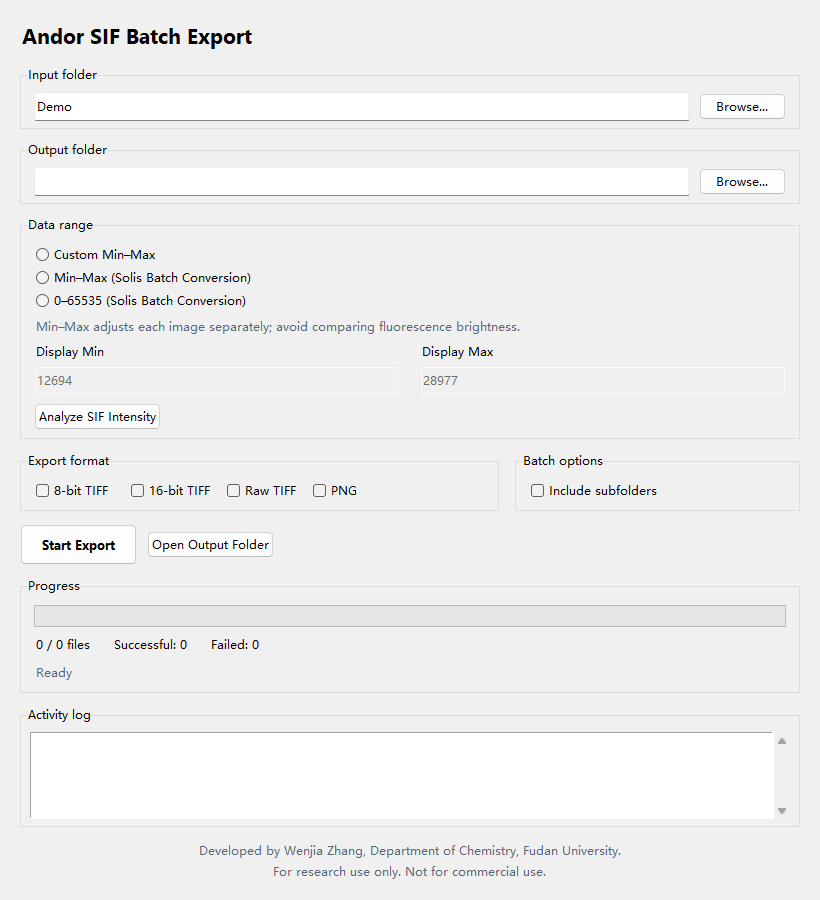

# Andor SIF Batch Export

Andor SIF Batch Export is a lightweight Windows application for batch conversion and export of Andor SIF image files. Its intensity range settings and image export options are designed with reference to Andor Solis.

Designed for research image workflows, including batch conversion and fixed intensity range export. Image Intensity Analysis is an additional utility. Independently developed software: not an official Andor product, not certified by Andor, and no affiliation, partnership or authorization is claimed.

## Features

- Read Andor SIF image files without changing source files.
- Export 8-bit grayscale TIFF, 16-bit grayscale TIFF, Raw TIFF and 8-bit grayscale PNG.
- Custom Min–Max, Min–Max and 0–65535 data ranges.
- Additional utility: Image Intensity Analysis and CSV statistics.
- Relative folder structure, per-frame export reports and read-back checks.
- Windows x64 standalone portable application.

## Data range modes

| Mode | Behavior |
| --- | --- |
| Custom Min–Max | Apply one user-defined range to all images; clip before linear mapping. |
| Min–Max | Use each frame's observed minimum/maximum. Separate stretching prevents direct comparison of original fluorescence brightness. |
| 0–65535 | Use the fixed range 0–65535; values outside it are clipped. |

Display mappings use floor quantization. 16-bit export maps directly from original values.
Constant frames are rejected in Min–Max mode because equivalent Solis behavior is unverified.
No background subtraction, gamma correction or additional enhancement is applied.

## Output formats

| Format | Pixel values | Orientation |
| --- | --- | --- |
| 8-bit TIFF | Mapped uint8 grayscale | Vertically flipped by default |
| 16-bit TIFF | Mapped uint16 grayscale | Vertically flipped by default |
| 8-bit PNG | Same decoded pixels as 8-bit TIFF | Vertically flipped by default |
| Raw TIFF | Unmapped parser values; float32 in validated files | Parser's original row order |

Default display orientation matches the tested Solis TIFFs. Raw TIFF preserves parsed values,
not all SIF headers or acquisition metadata. Keep original SIF files.
Display exports should not replace original data for quantitative analysis.

## Download and quick start

Download the latest Windows x64 portable package from the [Releases](https://github.com/ZhangWenJia-fdu/AndorSIFBatchExport/releases) page.

For v1.1.0, download `AndorSIFBatchExport_Windows_x64_v1.1.0.zip`.

1. Extract the entire ZIP into a new folder.
2. Keep the EXE, _internal and accompanying notices together, then run AndorSIFBatchExport.exe.
3. Select Input folder, Output folder and one or more export formats.
4. For display formats choose Data range. Custom Min–Max requires finite values with Max greater than Min.
5. Optionally enable Include subfolders, then click Start Export.

Raw-only export needs no data range. Existing image outputs are not overwritten.
Outputs use display_tiff_8bit, display_tiff_16bit, display_png, raw_tiff and reports folders.
Requires Windows 10/11 x64. The portable build is designed to run without Python, Solis or a connected camera;
testing on another clean Windows device remains outstanding. The EXE is unsigned. Before use, read MICROSOFT_RUNTIME_TERMS.txt
and the included Microsoft runtime license. Use of the bundled Microsoft
components requires acceptance of those terms.

## Image intensity analysis

Select an input folder and click Analyze SIF Intensity. Analysis follows Include subfolders
and needs no output folder, display range or export format.

Results include per-frame Min, Max, Mean, Median, P1 and P99, batch extrema and the overall range.
Calculations use original parsed pixels and float64; P1/P99 use linear percentile interpolation.
Analysis does not change Custom Min/Max.
NaN/Inf frames are excluded in full; valid sibling frames can contribute. Files analyzed
and failed/partial counts may overlap. Empty results display N/A.
Export CSV saves summary, statistics and errors as UTF-8 BOM CSV.
Reports include selected paths and filenames: review them before sharing.

## Screenshot

Actual final v1.1.0 EXE. Demo is an empty demonstration folder; the shown Min/Max are example parameters. No research images or experimental filenames are displayed.

## Validation and compatibility

The locally validated baseline was checked with 22 real SIF files.
All 23,068,672 compared display pixels across 88 TIFFs in four Solis Batch Conversion
reference groups matched exactly. Official ATSIFIO SDK 2.100.30039.0 independently
matched raw pixels and independently calculated statistics. The SDK was used only
for local validation; it is not required at runtime or included.

Coverage is limited to tested positive-integer, single-frame, single-ROI 512×512 files.
It does not establish support for every SIF variant, instrument or Solis version.
Real multi-frame/multi-ROI, constant, negative, fractional and nonfinite data lack
equivalent Solis reference coverage; some behaviors have synthetic tests only.
Direct Solis GUI statistics comparison is incomplete. Internal export/read-back
success alone does not establish independent SIF-reader accuracy.

## Run from source

Use 64-bit Python 3.13 with Tkinter on Windows. From the project folder:

~~~powershell
py -3.13 -m venv .venv
.\.venv\Scripts\python.exe -m pip install -r requirements.txt
.\.venv\Scripts\python.exe scripts\gui.py
~~~

Optional CLI example; replace the input/output folders with your own:

~~~powershell
.\.venv\Scripts\python.exe scripts\batch_export_sif.py --input .\input --output .\output\example --data-range custom --min 100 --max 1000 --tiff8 y --tiff16 y --raw-tiff y --png y --recursive n --no-interactive
~~~

Public synthetic/GUI tests:

~~~powershell
.\.venv\Scripts\python.exe -m pip install -r requirements-dev.txt
.\.venv\Scripts\python.exe -m pytest -q
~~~

These tests need no research data or SDK and do not reproduce all real-data
validation. Pins record the validated environment;
a new installation still requires availability of those packages.

## Build from source

~~~powershell
.\.venv\Scripts\python.exe -m pip install -r requirements-build.txt
powershell -NoProfile -ExecutionPolicy Bypass -File .\build_release.ps1
powershell -NoProfile -ExecutionPolicy Bypass -File .\package_release.ps1
~~~

PyInstaller creates an onedir build in build/v1.1.0/dist.
Packaging writes to release and refuses to overwrite an existing ZIP.
Packaging requires a licensed Visual Studio installation with x64 CRT files.
The packaging script discovers its REDIST folder using vswhere; alternatively set
`ANDOR_VC_REDIST_DIR` to the approved x64 Microsoft.VC*.CRT folder.
Builds require Windows 10/11 x64. Use a clean Python environment and an approved
Microsoft redistributable source; do not collect DLLs from unrelated tool directories.
Redistribution of Microsoft runtime files requires the applicable Visual Studio
license and redistribution terms. See THIRD_PARTY_NOTICES.md.

## Developer and usage notice

Developed by Wenjia Zhang, Department of Chemistry, Fudan University.

For research use only. Not for commercial use.

Copyright (c) 2026 Wenjia Zhang. All rights reserved.

This copyright notice applies only to original project content in which Wenjia Zhang
holds copyright; it does not apply to third-party components.
The developer's academic affiliation identifies the developer only. Fudan University
does not own, officially release, endorse or provide official support for this software.

This is source-available research software under the
[Non-Commercial Research Use License](LICENSE). You may download it free of charge,
use it for non-commercial research, inspect the source, and build and run unmodified
source for that purpose. Modification, derivative development, redistribution and
commercial use require separate authorization, subject to rights preserved by law,
applicable platform terms and third-party licenses. The license does not restrict
publication of your experimental data, processed results or research findings.

## Third-party software and acknowledgment

SIF parsing uses the external [sif_parser 0.3.6](https://pypi.org/project/sif-parser/0.3.6/)
dependency from [fujiisoup/sif_parser](https://github.com/fujiisoup/sif_parser), declared
under BSD-3-Clause. Its history credits soemraws's Python plugin, based on Marcel
Leutenegger's MATLAB script. The parser's own license and the original MATLAB
license (Copyright (c) 2006, Marcel Leutenegger) are preserved separately in
[third_party/licenses/sif_parser](third_party/licenses/sif_parser).
The application calls `sif_parser.np_open`; it does not include an Andor official
parser implementation. These third-party licenses are independent of the
project license.
Other components include Python/Tkinter/Tcl/Tk, NumPy, Pillow and tifffile.
See [THIRD_PARTY_NOTICES.md](THIRD_PARTY_NOTICES.md) and accompanying license texts.
